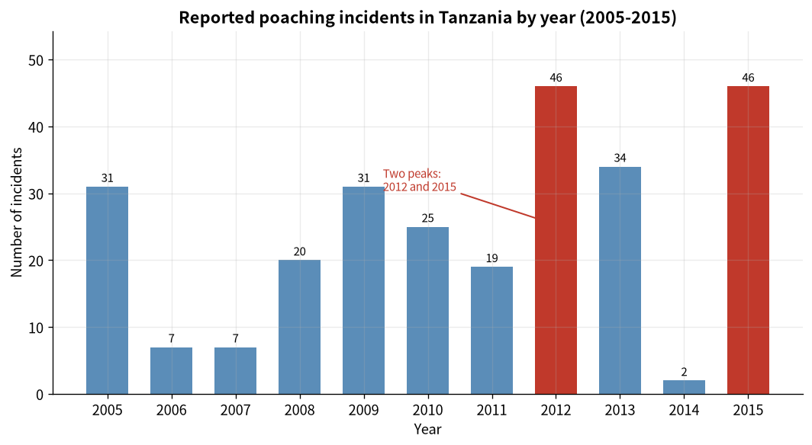

# Data Science Portfolio

## About me

I am a postgraduate student in the **MSc in Data Science** programme at the **University of
Macau** (Hongkai Lin / 林鸿凯, student ID: mc642646). My interests lie in turning messy, real-world data into clear
evidence: cleaning and reshaping raw records, exploring them from both a temporal and a spatial
angle, and communicating what the data can - and cannot - support. This site is where I document
that work as it develops.

---

## Technical skills

| Area | Skills and tools |
| --- | --- |
| **Languages** | Python, SQL (basic), Markdown |
| **Data analysis** | pandas, NumPy - loading, cleaning, reshaping, grouping and aggregation |
| **Visualization** | matplotlib, seaborn; geoplotlib for geospatial layers; chart design for clear communication |
| **Statistics / ML** | regression modelling, model evaluation (R², MSE), residual diagnostics, train/test validation |
| **Tools & workflow** | Jupyter Notebook, Anaconda, Git & GitHub, GitHub Pages |

---

## Project showcase

### Poaching in Tanzania: When and Where Do Incidents Cluster?

**Research question.** When and where do reported wildlife poaching incidents concentrate in
Tanzania, and what does the temporal and spatial pattern suggest for where anti-poaching effort
should be directed?

**Visualization**

**What the findings show.** Using 268 reported incidents from 2005 to 2015, the analysis finds
that incidents are far from evenly distributed. Across time, two years dominate - 2012 and 2015,
with 46 incidents each - while 2014 records almost none. Combining all years reveals a seasonal
cycle: incidents peak sharply in January, show a secondary peak in July-August (Tanzania's dry
season, when thin vegetation makes detection easier), and fall to their lowest in
October-November. Spatially, incidents cluster in a western and south-western corridor rather
than being spread across the country, suggesting that a small number of areas account for a
disproportionate share of reported incidents.

The most important caveat is that the data record *reported* incidents, and the two date fields
are internally inconsistent (the median reporting delay is negative). The patterns should
therefore be read as patterns in **reporting and detection**, not necessarily in poaching
activity itself.

**Repository.** [data-science-project](https://github.com/hastur888/data-science-project)

**Status.** ✅ Completed

---

## Declaration of AI usage

Parts of the content on this site were drafted with the assistance of an AI LLM, and are declared
in the course forum. All content was reviewed and verified by the author, who is responsible for
the final version.

- Student ID: mc642646 — Hongkai Lin (林鸿凯)
